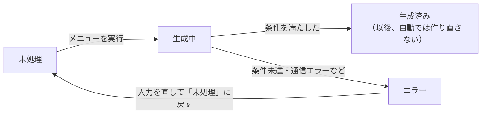

# 使い方マニュアル（GAS AIブログ記事自動生成）

> Claude.ai 上の資料「使い方マニュアル」の内容を、GitHub で読めるよう Markdown に転記したものです（2026-11-12 時点）。関連資料：[APIキー設定手順書](API_KEY_SETUP.md) ／ [トラブルシューティング](TROUBLESHOOTING.md)

## はじめに

このスプレッドシートでは、入力したキーワードとタイトルから、ブログ記事の本文とメタディスクリプションを AI（Claude）で自動作成できます。メニューを1回実行するごとに、記事を1件作ります。

| 項目 | 内容 |
| --- | --- |
| 作成されるもの | 記事本文（HTML形式、HTMLタグを除いて2,000〜3,000字）とメタディスクリプション（120字以内） |
| 1回の実行で作る件数 | 1件 |
| 作らないもの | タイトル（入力したものを使います） |
| 自動で行わないこと | WordPress への投稿 |

使い始める前に、APIキー・単価（入力・出力）・対象シート名の設定が必要です。APIキーは別紙「[APIキー設定手順書](API_KEY_SETUP.md)」の手順で、単価は「記事生成」→「単価を設定」で、対象シート名は「記事生成」→「対象シート名を設定」で登録します。設定できているかは、「記事生成」→「設定状況を確認」で確かめられます。

## シートの構成

入力するのは A・B・C・D 列です。F・G 列は自動で書き込まれるので、空欄のままにします。1行目は見出し行で、記事は2行目から1行に1件ずつ入力します。

| 列 | 項目 | 入力する人 | 内容 |
| --- | --- | --- | --- |
| A | キーワード | あなた（**必須**） | 記事のメインキーワード |
| B | サブキーワード | あなた（任意） | 本文に自然に含めたい言葉。空欄でも生成できます |
| C | ステータス | あなた＋自動 | 生成したい行は「未処理」と入力。その後は自動で更新されます |
| D | タイトル | あなた（**必須**） | 記事のタイトル。AIはこのタイトルに沿って書き、書き換えません |
| E | WordPress URL | あなた（投稿後に手入力） | 投稿した記事のURL。システムはこの列に触れません |
| F | 記事本文 | 自動 | HTML形式の本文。生成前は空欄にしておきます |
| G | メタディスクリプション | 自動 | 120字以内の説明文。生成前は空欄にしておきます |

記事のデータがあるシート（「対象シート名を設定」で登録したシート。例：「シート1」）とは別に、「生成ログ」シートがあります。初めて記録するときに自動で作られ、生成の経過が記録されます。

## 手順1：記事の情報を入力する

作りたい記事1件につき、1行を使います。

1. 記事のデータがあるシートを開き、空いている行（2行目以降）を選びます。
2. A列にキーワードを入力します（例：勤怠管理 エクセル）。
3. 必要なら、B列にサブキーワードを入力します。不要なら空欄のままで構いません。
4. D列に記事のタイトルを入力します。
5. F列とG列が空欄であることを確認します。
6. 最後に、C列に「未処理」と入力します。この入力で、その行が生成の対象になります。

「未処理」は正確に入力してください。前後の空白は無視されますが、ほかの文字が付いていると生成の対象になりません。「未処理」の行でも、F列かG列に何か入っている行は、既存の内容を守るため生成されずに飛ばされます。

## 手順2：「記事生成」メニューから記事を生成する

メニューを1回実行すると、「未処理」の行のうち**いちばん上の1行だけ**が生成されます。

F列・G列に値がある行は飛ばされます。対象になった行でA列かD列が空のときは、その行が「エラー」になり、その回は記事を作らずに終わります。

1. スプレッドシートを開きます。上部に「記事生成」メニューがない場合は、ページを再読み込みします。
2. 「記事生成」→「未処理を1件生成」を選びます。
3. 対象の行のC列が「生成中」に変わります。完了のメッセージが出るまで待ちます。この間、その行は編集しないでください。
4. 「○行目の記事を生成しました。」と表示されたら完了です。メッセージには次の内容が表示されます。
    - 本文とメタディスクリプションの文字数
    - APIの呼び出し回数（作り直した場合は2回）
    - 入力・出力のトークン数と、推定費用
5. 「OK」を押してメッセージを閉じます。
6. 次の記事も作る場合は、2. から繰り返します。

エラーのメッセージが出た場合は、「[うまくいかないとき](#うまくいかないとき)」の表を見てください。既に入っている本文やメタディスクリプションが、エラーで消されることはありません。

## 手順3：生成結果を確認する

生成結果は、対象の行の C列（ステータス）、F列（本文）、G列（メタディスクリプション）で確認します。

1. C列が「生成済み」になっていることを確認します。
2. F列のセルを選び、画面上部の数式バーで本文全体を確認します。
    - 本文はHTML形式なので、`
` や `<h2>` などのタグが文字のまま見えます。これは正常です。
    - 導入の段落、`<h2>` と `<h3>` の見出しで構成されます。最後の `<h2>` 見出しが「まとめ」であることは自動で確認されます。導入の段落や `<h3>` はAIへの指示に含まれますが、自動の確認対象ではありません。
3. G列のメタディスクリプション（120字以内のプレーンテキスト）を確認します。
4. 文字数は、完了メッセージか「生成ログ」シートの「本文文字数」「メタ文字数」で確認します。本文の文字数はHTMLタグを除いて数えています。シートの `LEN` 関数はタグも数えるため、値が大きくなります。
5. 内容を読み、事実と違う記述や不自然な表現がないかを人の目で確認します。AIが書いた文章には誤りが含まれることがあります。

### ステータスの意味

「生成済み」と「エラー」の行は自動では処理されません。エラーの行は、原因を直してC列を「未処理」に戻すとやり直せます。A列・D列が空の行は、「生成中」を経ずに「エラー」になります。

| C列の表示 | 意味 | すること |
| --- | --- | --- |
| 未処理 | 生成を待っている | 「未処理を1件生成」を実行する |
| 生成中 | 生成の処理中 | 完了メッセージを待つ。メニューを実行してから10分以上たっても変わらない場合は「うまくいかないとき」を参照 |
| 生成済み | F列・G列に書き込み済み | 内容を確認する。この行は以後、自動で作り直されません |
| エラー | 生成できなかった | 「生成ログ」で理由を確認する（「うまくいかないとき」参照） |

## 生成ログの見方

「生成ログ」シートには、AIへの依頼1回ごとの記録と、記事1件の結果をまとめた「記事合計」の記録が残ります。スキップ・入力チェック・接続テストなどの記録も、同じシートに追加されます。新しい記録はいちばん下に追加されます。記録用のシートなので、内容は編集しないでください。

### よく見る列

| 列名 | 内容 |
| --- | --- |
| 日時 | 記録した日時 |
| 実行ID | 1回のメニュー実行ごとの番号。同じIDの行が1回分の記録です |
| 対象行 | 記事データのシートの行番号 |
| 種別 | 生成／再生成／記事合計／スキップ／入力チェック／接続テスト／エラー |
| 結果 | OK（条件を満たした）／NG（条件を満たさなかった。1回目なら自動で作り直し）／APIエラー／生成済み／エラー／スキップ |
| 本文文字数・メタ文字数 | その回に作られた文章の文字数（本文はHTMLタグを除く） |
| メッセージ | NGやエラーの理由。「記事合計」の行では、成功時はAPIの呼び出し回数、失敗時はエラーの理由。作り直しのときは、見つかった問題がAIに伝えられます |
| 今回費用・記事合計費用(USD) | 1回分の費用と、作り直しを含む記事1件の合計費用 |

このほかに、トークン数・単価・応答モデル・stop_reason・リクエストIDの列があります。リクエストIDは、サポート窓口へ問い合わせるときに使います。

### 作り直し（再生成）があったかを確認する

本文の文字数不足や書式の誤りなどで条件を満たさない場合、自動で**最大1回**作り直されます。次の手順で確認できます。

1. 「生成ログ」シートを開きます。
2. 「対象行」が確認したい行番号で、いちばん下にある「記事合計」の行を探します。
3. その行の「メッセージ」が「API呼び出し 2 回」なら、作り直しがあったということです。結果が「エラー」の場合は、メッセージにエラーの理由が入るため、同じ実行IDの「生成」「再生成」の行を見ます。
4. 同じ「実行ID」の「生成」の行を見て、「メッセージ」で作り直しの理由を確認します。
5. 「再生成」の行の「結果」と「本文文字数」で、作り直し後に条件を満たしたかを確認します。

作り直しがあった場合の記録の例です（文字数は例）。

| 種別 | 結果 | 本文文字数 | メッセージ |
| --- | --- | --- | --- |
| 生成 | NG | 1850 | 本文の文字数（HTMLタグ除く）が 1850 字です。2000〜3000 字にしてください。 |
| 再生成 | OK | 2420 | （空欄） |
| 記事合計 | 生成済み | 2420 | API呼び出し 2 回 |

作り直しても条件を満たさない場合は、「再生成」の結果もNGになり、「記事合計」の結果が「エラー」になります。このときシートのC列は「エラー」になり、F列・G列には何も書き込まれません。作り直した分も費用がかかり、「記事合計費用」に含まれます。

## WordPressへの投稿について

このスプレッドシートは、WordPress への投稿を**自動では行いません**。生成した記事は、内容を確認してから手作業で投稿してください。

1. 手順3で内容を確認し、必要なら修正します。
2. WordPress の投稿画面で、D列のタイトルを入力します。
3. F列の本文をコピーし、HTMLをそのまま入力できる場所に貼り付けます。通常の文章として貼り付けると、`
` などのタグが文字のまま表示されることがあります（WordPress 側の表示は、このシステムでは未確認です）。
4. G列のメタディスクリプションを、サイトで使っている設定欄に入力します。
5. 投稿したら、記事のURLをE列に入力します。

貼り付け先やメタディスクリプションの入力欄は、WordPress のエディターやプラグインによって異なります。サイトの運用ルールに従ってください。

## うまくいかないとき

表示されたメッセージを左列で探してください。ここにないメッセージや詳しい原因は、別紙「[トラブルシューティング](TROUBLESHOOTING.md)」を見てください。APIキーに関するものは、別紙「[APIキー設定手順書](API_KEY_SETUP.md)」の「困ったとき」も参照してください。

| メッセージ・状態 | 原因 | 対処 |
| --- | --- | --- |
| 「処理対象の「未処理」行はありません。」 | C列が「未処理」で、F列・G列が空欄の行がない | 手順1のとおりに入力する |
| 「スキップした「未処理」行（既存データ保護）」 | 「未処理」なのにF列かG列に値がある | その値が不要なら空欄にする。必要ならそのままで構いません |
| 「○行目: A列（キーワード）…が空のため生成できません。ステータスを「エラー」にしました。」 | A列またはD列が空欄（C列は「エラー」になる） | A列・D列を入力し、C列を「未処理」に戻して実行する |
| 「エラーが発生しました。」に続けて「次の設定が未登録です: …」 | APIキー・単価・対象シート名のいずれかが未設定 | 「APIキー設定手順書」と「記事生成」メニューで設定する |
| 「別の生成処理が実行中です。…」 | 他の人または別の画面で生成中 | 完了を待ってから実行する |
| 「エラーが発生しました（○行目）。…」 | 作り直しても条件を満たさない、通信エラーなど | 「生成ログ」のメッセージで理由を確認し、下の手順でやり直す |
| C列が「生成中」のままで、完了メッセージが出ない | まだ処理中か、処理が途中で終わった（「生成中」のまま残る具体的な条件は未確認） | すぐにC列を書き換えない。メニューを実行してから10分以上たっても変わらなければ、下の手順でやり直す |

### 「エラー」や「生成中」の行をやり直す

**「生成中」の行は、まだ処理が動いている可能性があります。** メニューを実行してから10分たつまでは、C列を書き換えないでください。スクリプトは開始から5分を過ぎると新しいAIへの依頼を始めない作りです。Apps Script の1回の実行時間には上限があります（Google の公開情報では6分。この環境での実測は未確認）。誤って処理中に「未処理」へ戻しても、元の処理は書き込み前の確認で中止され、本文は上書きされませんが、その処理の費用は無駄になります。

1. 「生成ログ」で、その行のエラーの理由を確認します。
2. 入力の不備が理由なら、A列・D列などを直します。
3. F列とG列が空欄であることを確認します。
4. C列を「未処理」に戻します。
5. 「記事生成」→「未処理を1件生成」を実行します。

### 「生成済み」の記事を作り直したいとき

「生成済み」の行は、既存の記事を守るため自動では作り直されません。作り直すと今の本文は消え、費用もあらためてかかります。

1. 今の本文を残したい場合は、別の場所にコピーしておきます。
2. F列とG列を空欄にします。
3. C列を「未処理」に戻し、「未処理を1件生成」を実行します。
